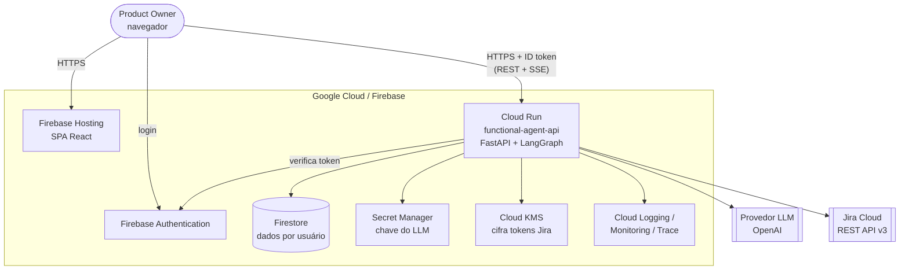
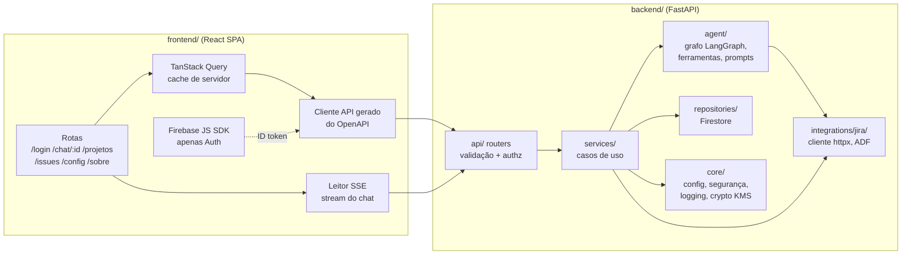
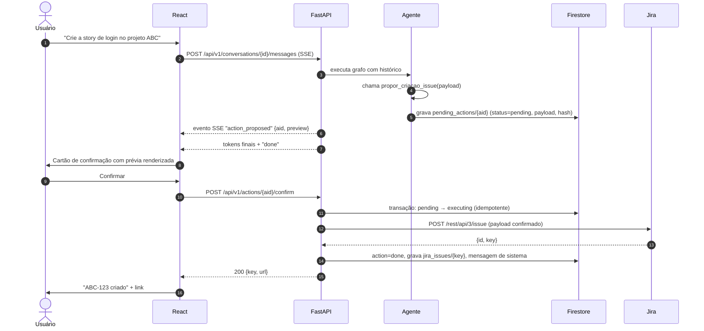
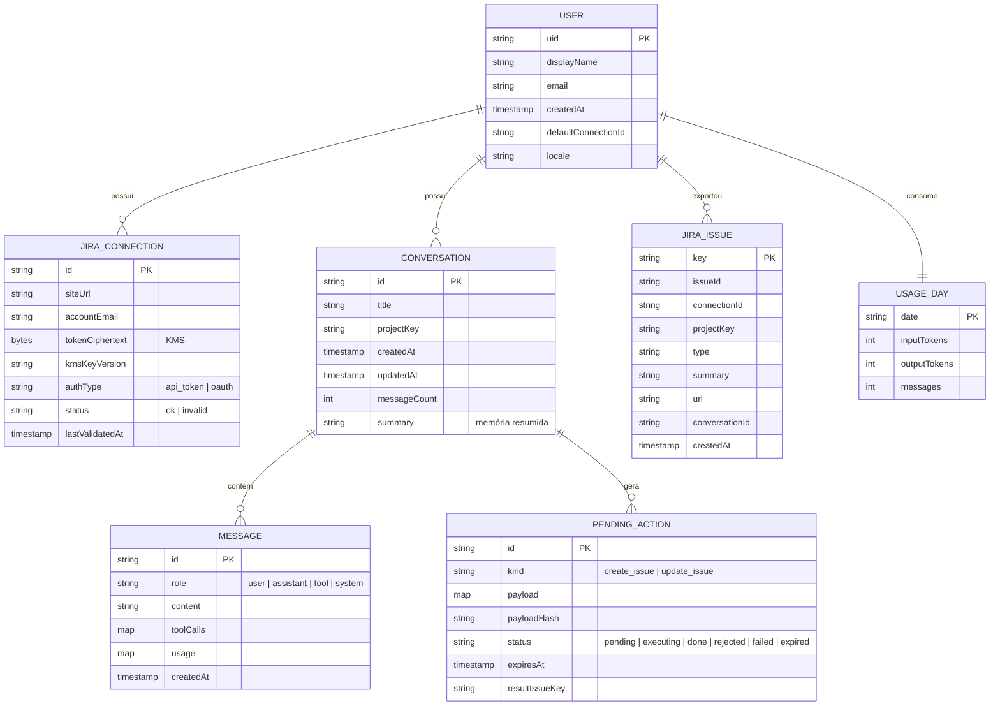

# 03 — Arquitetura alvo

## 1. Visão de contexto



### Por que a API é chamada diretamente (e não via rewrite do Hosting)

O Firebase Hosting consegue encaminhar `/api/**` para o Cloud Run, mas esse caminho tem **limite de 60 s
por requisição**. Um turno do agente com várias chamadas de ferramenta e streaming pode passar disso. Por isso:

- O SPA chama a API em `https://api.<domínio>` (mapeamento de domínio do Cloud Run) ou na URL `*.run.app`.
- A autenticação é por **`Authorization: Bearer <Firebase ID token>`** (sem cookies), então CORS fica simples:
  origem permitida = domínio do Hosting.
- Detalhes e alternativas (Load Balancer HTTPS, rewrite só para rotas curtas) em [ADR-002](adr/ADR-002-hosting-e-cloud-run.md).

---

## 2. Containers e responsabilidades



### Regras de dependência do backend (verificadas por `import-linter` no CI)

```
api  →  services  →  agent, integrations, repositories  →  core
```
- `api` não fala com Firestore nem com Jira diretamente.
- `agent` não conhece HTTP/FastAPI; recebe dependências por injeção (contexto da execução).
- `core` não importa nada das camadas acima.

---

## 3. O agente

### 3.1 Desenho

- **LangGraph** substitui o `AgentExecutor` descontinuado ([ADR-003](adr/ADR-003-agente-langgraph-acoes-propostas.md)).
- Grafo ReAct: `modelo ⇄ ferramentas`, máximo de **8 iterações** por turno.
- O agente é **sem estado no processo**: a cada requisição o backend carrega o histórico da conversa do
  Firestore, aplica janela/sumarização por orçamento de tokens e executa o grafo.
- O cliente Jira **do usuário** é injetado no contexto da execução (`RunnableConfig`), nunca em variável global.
- Modelo configurável por variável de ambiente (`LLM_PROVIDER`, `LLM_MODEL`), via `init_chat_model`.

### 3.2 Ferramentas

| Ferramenta | Tipo | Execução | Limites |
|---|---|---|---|
| `listar_projetos` | leitura | automática | cache 5 min |
| `consultar_issue(key)` | leitura | automática | campos selecionados |
| `buscar_issues_jql(jql, limite≤50)` | leitura | automática | máx. 50 resultados, campos resumidos |
| `listar_issues_do_epico(key)` | leitura | automática | máx. 50 |
| `propor_criacao_issue(...)` | **escrita** | **gera ação proposta** | — |
| `propor_atualizacao_issue(key, campos)` | **escrita** | **gera ação proposta** | só `summary`, `description`, `priority`, `labels` |

Conteúdo devolvido pelo Jira é marcado como **dado não confiável** no prompt (mitigação de prompt injection);
como nenhuma escrita acontece sem confirmação humana, uma injeção não consegue alterar o Jira sozinha.

### 3.3 Padrão "ação proposta" (humano no controle)



- A execução **não passa pelo LLM**: é determinística, com o payload exato confirmado.
- Ações expiram em 24 h (TTL do Firestore). "Recusar" grava `status=rejected` e informa o agente no próximo turno.
- Idempotência: transição de estado em transação Firestore; um duplo clique não cria dois issues.

### 3.4 Streaming

`POST /api/v1/conversations/{id}/messages` responde `text/event-stream` com eventos:

| Evento | Payload | Uso no front |
|---|---|---|
| `token` | `{text}` | Anexa texto à resposta |
| `tool_start` / `tool_end` | `{name, summary}` | Indicador "Consultando Jira…" |
| `action_proposed` | `{action_id, kind, preview}` | Cartão de confirmação |
| `message_saved` | `{message_id}` | Reconciliação do cache |
| `error` | `{code, message}` | Toast + opção de tentar de novo |
| `done` | `{usage}` | Finaliza o turno |

O Cloud Run suporta respostas em streaming; o `timeout` do serviço é configurado em 300 s.

---

## 4. Dados — Firestore

### 4.1 Por que Firestore

Resumo do [ADR-001](adr/ADR-001-firestore.md): os dados são **documentos por usuário** (perfil, conexões,
conversas, mensagens, issues, ações) acessados quase sempre por `uid` + ordenação por data. Não há relatórios
analíticos nem joins complexos. Firestore entrega isso sem servidor, com nível gratuito, escala a zero e
integração nativa com Firebase Auth. Cloud SQL foi descartado por custo fixo mensal e operação.

### 4.2 Modelo de dados



### 4.3 Caminhos

```
users/{uid}
users/{uid}/jira_connections/{connectionId}
users/{uid}/conversations/{conversationId}
users/{uid}/conversations/{conversationId}/messages/{messageId}
users/{uid}/pending_actions/{actionId}
users/{uid}/jira_issues/{issueKey}
users/{uid}/usage/{yyyy-mm-dd}
```

- **Isolamento por caminho:** um bug de query não consegue atravessar usuários, pois toda leitura parte de `users/{uid}`.
- **Mensagens em subcoleção:** evita o limite de 1 MiB por documento.
- **TTL:** `pending_actions.expiresAt` (24 h). Conversas não expiram (o usuário exclui).
- **Índices compostos** (em `firestore.indexes.json`): `conversations(updatedAt desc)`, `jira_issues(projectKey, createdAt desc)`.
- **Regras de segurança:** `allow read, write: if false;` para clientes — só o backend (Admin SDK, IAM) acessa.
- **Exclusão de conta:** `recursiveDelete(users/{uid})` + exclusão no Firebase Auth.

---

## 5. Segurança

| Ameaça | Controle |
|---|---|
| Acesso não autenticado à API | Verificação do Firebase ID token em todas as rotas (exceto `/healthz`) |
| Abuso por bots / scripts | **Firebase App Check** (reCAPTCHA Enterprise) verificado no backend; limites por usuário |
| Vazamento entre usuários | Caminhos `users/{uid}`; `uid` sempre vem do token, nunca do corpo da requisição; testes de autorização |
| Roubo do token Jira | Envelope encryption KMS; token nunca volta ao cliente; IAM de decrypt só para a SA do Cloud Run |
| Prompt injection via Jira | Conteúdo externo marcado como não confiável + escrita só com confirmação humana |
| Custos descontrolados de LLM | Cota diária por usuário (tokens e mensagens), alerta de orçamento GCP |
| XSS no Markdown do agente | `react-markdown` sem HTML bruto + sanitização; CSP restritiva no `firebase.json` |
| Cadeia de suprimentos | Lockfiles (`uv.lock`, `package-lock.json`), Dependabot, `pip-audit`, `npm audit`, imagens com digest |
| Credenciais de deploy | Workload Identity Federation; nenhuma chave de service account em JSON |

---

## 6. API v1 (resumo)

| Método | Rota | Descrição | Feature |
|---|---|---|---|
| GET | `/healthz` | Liveness (sem auth) | F02 |
| GET | `/api/v1/me` | Perfil do usuário (cria no 1º acesso) | F03 |
| DELETE | `/api/v1/me` | Exclui conta e todos os dados | F03 |
| GET | `/api/v1/me/export` | Exporta dados (JSON) | F03 |
| GET/POST/DELETE | `/api/v1/jira/connections[/{id}]` | Gerencia conexões Jira | F04 |
| POST | `/api/v1/jira/connections/{id}/validate` | Testa a conexão | F04 |
| GET | `/api/v1/jira/projects` | Lista projetos (com contagem) | F09 |
| GET/POST | `/api/v1/conversations` | Lista/cria conversas | F07 |
| GET/PATCH/DELETE | `/api/v1/conversations/{id}` | Detalhe, renomear, excluir | F07 |
| GET | `/api/v1/conversations/{id}/messages` | Histórico paginado | F07 |
| POST | `/api/v1/conversations/{id}/messages` | Envia mensagem (SSE) | F05 |
| POST | `/api/v1/actions/{id}/confirm` | Executa ação proposta | F06 |
| POST | `/api/v1/actions/{id}/reject` | Recusa ação proposta | F06 |
| GET | `/api/v1/jira/issues` | Histórico de issues criados | F10 |

Erros seguem **RFC 9457 (Problem Details)**: `{type, title, status, detail, code}`.

---

## 7. Estrutura do repositório (monorepo)

```
FunctionalAgent/
├── backend/
│   ├── app/
│   │   ├── api/v1/            # routers FastAPI
│   │   ├── services/          # casos de uso
│   │   ├── agent/             # grafo, tools, prompts/system_v1.md
│   │   ├── integrations/jira/ # cliente httpx, markdown→ADF
│   │   ├── repositories/      # Firestore
│   │   ├── core/              # config, auth, crypto, logging
│   │   └── main.py
│   ├── tests/ {unit,integration,contract,evals}
│   ├── pyproject.toml · uv.lock · Dockerfile
├── frontend/
│   ├── src/ {routes,components,features,api,lib,i18n}
│   ├── e2e/                   # Playwright
│   ├── package.json · vite.config.ts
├── infra/
│   ├── modules/ {cloud_run,firestore,kms,secrets,wif,monitoring}
│   └── envs/ {dev,prd}
├── docs/ {modernizacao, adr, features}
├── firebase.json · .firebaserc · firestore.rules · firestore.indexes.json
├── docker-compose.yml         # backend + emuladores Firebase para dev local
├── legacy/                    # Streamlit atual, até o go-live (F12)
└── .github/workflows/
```
