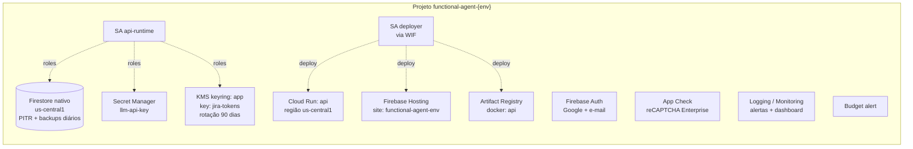

# 05 — Infraestrutura (GCP + Firebase)

> **Revisão 2026-11-14 (decisão do PO):** o app vive no projeto compartilhado `pcb-inspect`, com um
> ambiente só (produção) + previews, recursos com prefixo `specflow` e banco Firestore `specflow`.
> As tabelas abaixo descrevem o plano original por ambiente; a configuração vigente está em
> `infra/terraform/envs/prd.tfvars` e em `infra/bootstrap/README.md`.

## 1. Ambientes

| Ambiente | Projeto GCP/Firebase | Propósito | Cloud Run | Dados |
|---|---|---|---|---|
| `local` | — (emuladores) | Desenvolvimento | `uvicorn --reload` | Emulador Firestore/Auth |
| `dev` | `functional-agent-dev` | Integração contínua, previews, E2E | `min=0`, `max=3` | Firestore dev, Jira sandbox |
| `stg` *(opcional)* | `functional-agent-stg` | Ensaio de release | `min=0`, `max=3` | Cópia sintética |
| `prd` | `functional-agent-prd` | Usuários reais | `min=0` (decisão do PO), `max=20` | Firestore prd, PITR ativo |

Um **projeto GCP por ambiente** (isolamento de IAM, cotas e faturamento). Cada projeto GCP é também um projeto Firebase.

## 2. Recursos por ambiente



### Terraform — módulos

| Módulo | Recursos principais |
|---|---|
| `project_services` | Habilita APIs: run, firestore, secretmanager, cloudkms, artifactregistry, firebase, identitytoolkit, firebaseappcheck, monitoring |
| `firestore` | `google_firestore_database` (nativo), índices, campo TTL `pending_actions.expiresAt`, PITR, `google_firestore_backup_schedule` |
| `kms` | Keyring `app`, chave `jira-tokens` (rotação 90 d), IAM `cryptoKeyEncrypterDecrypter` só para `api-runtime` |
| `secrets` | `llm-api-key` (o valor é inserido fora do Terraform, nunca no estado) |
| `cloud_run` | Serviço `api`, SA de runtime, envs, secrets montados, `timeout=300s`, `concurrency=40`, CPU 1 / 1 GiB, *startup probe* em `/healthz` |
| `artifact_registry` | Repositório Docker com política de limpeza (manter 20 últimas) |
| `firebase` | `google_firebase_project`, web app, site de Hosting, provedores de Auth, App Check |
| `wif` | Pool + provider OIDC do GitHub restrito a `repository == micaelleos/FunctionalAgent` e branch/ambiente |
| `monitoring` | Uptime check, alertas (5xx > 2%, p95 > 10 s, erros de LLM, orçamento), dashboard |
| `domain` *(opcional)* | Mapeamento `api.<domínio>` no Cloud Run, domínio customizado no Hosting |

Estado remoto: bucket `gs://functional-agent-tfstate-{env}` com versionamento e *uniform bucket-level access*.

## 3. IAM (mínimo privilégio)

| Principal | Papéis | Escopo |
|---|---|---|
| `api-runtime@` (SA do Cloud Run) | `roles/datastore.user` | projeto |
| | `roles/secretmanager.secretAccessor` | **apenas** o secret `llm-api-key` |
| | `roles/cloudkms.cryptoKeyEncrypterDecrypter` | **apenas** a chave `jira-tokens` |
| | `roles/firebaseauth.viewer` *(se necessário p/ exclusão: `firebaseauth.admin`)* | projeto |
| | `roles/cloudtrace.agent`, `roles/logging.logWriter` | projeto |
| `deployer@` (via WIF, GitHub Actions) | `roles/run.developer`, `roles/artifactregistry.writer`, `roles/firebasehosting.admin`, `roles/iam.serviceAccountUser` (em `api-runtime`) | projeto |
| `terraform@` (via WIF, workflow de infra) | papéis administrativos necessários | projeto, só no workflow `infra.yml` com aprovação |
| Pessoas (dono do produto/dev) | `roles/viewer` em prd; acesso de escrita só via *break-glass* | projeto |

## 4. Configuração do Cloud Run (prd)

| Parâmetro | Valor | Motivo |
|---|---|---|
| Região | `us-central1` | Decisão do PO (2026-11-14) |
| CPU / memória | 1 vCPU / 1 GiB | Agente é I/O-bound; LangGraph + SDKs cabem folgado |
| Concorrência | 40 | FastAPI async; ajustar após teste de carga |
| Timeout | 300 s | Turnos longos do agente com streaming |
| Min / max instâncias | 0 / 20 | Decisão do PO (2026-11-14): cold start aceito; teto de custo |
| CPU boost na inicialização | ligado | Reduz cold start |
| Ingress | `all` (público, auth na aplicação) | SPA chama direto; App Check + ID token protegem |
| Env | `ENV`, `GCP_PROJECT`, `KMS_KEY_NAME`, `LLM_PROVIDER`, `LLM_MODEL`, `CORS_ORIGINS`, `DAILY_TOKEN_QUOTA` | — |
| Secrets | `LLM_API_KEY` ← `llm-api-key:latest` | Artigo III |

## 5. Firebase Hosting (`firebase.json`)

- `public: frontend/dist`, *rewrite* `** → /index.html` (SPA).
- Cabeçalhos: `Content-Security-Policy` (connect-src para a API, Firebase e reCAPTCHA), `Strict-Transport-Security`,
  `X-Content-Type-Options`, `Referrer-Policy`, `Permissions-Policy`; cache imutável para `/assets/**`.
- Canais de preview por PR (`firebase hosting:channel:deploy pr-<n> --expires 7d`).

## 6. Dados: backup e recuperação

| Item | Configuração | Objetivo |
|---|---|---|
| PITR (point-in-time recovery) | Ligado em prd (7 dias) | RPO ≤ 1 min para erros humanos/bugs |
| Backup agendado | Diário, retenção 14 dias | Recuperação de desastre |
| Teste de restauração | Trimestral, documentado em runbook | Garantir que o backup funciona |

## 7. Estimativa de custo mensal (prd, uso inicial: ~50 usuários ativos, ~5 mil mensagens/mês)

| Item | Estimativa (USD) | Observação |
|---|---|---|
| Cloud Run (`min=0`) | ~0–5 | 10–20 se passar a `min=1` |
| Firestore | 0–5 | Nível gratuito cobre boa parte |
| Firebase Hosting / Auth | 0 | Dentro do nível gratuito |
| App Check (reCAPTCHA Enterprise) | 0 | Até 10 mil avaliações/mês grátis |
| Secret Manager + KMS | < 1 | — |
| Logging / Monitoring | 0–5 | Atenção ao volume de logs |
| **LLM (tokens)** | **20–150** | **Custo dominante**; controlado por cotas (F11) |
| **Total** | **~35–180** | Configure *budget alert* em 50/90/100% |

> Os preços variam; valide na calculadora da GCP e do provedor de LLM antes da aprovação da F02.

## 8. Desenvolvimento local

```bash
make dev   # docker compose: emuladores Auth/Firestore + backend (reload) + frontend (vite)
```

- O backend detecta `FIRESTORE_EMULATOR_HOST` / `FIREBASE_AUTH_EMULATOR_HOST`.
- KMS local: implementação `LocalFernetCipher` habilitada **somente** quando `ENV=local` (teste garante que não é usada em outros ambientes).
- LLM local: chave do dev em `.env.local` (ignorado pelo git) ou modelo *fake* para trabalhar offline.
