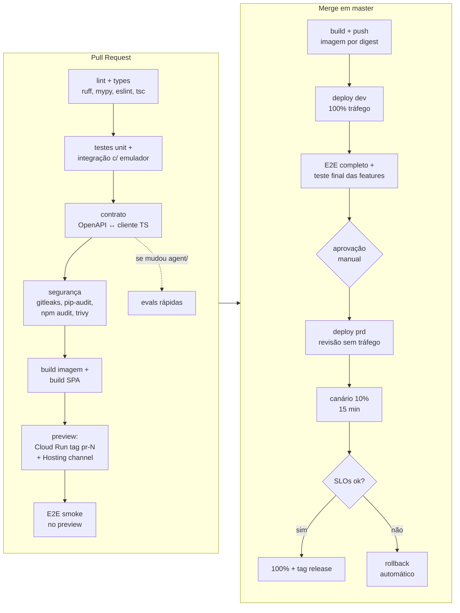

# 06 — CI/CD e deploy

> **Revisão 2026-11-14 (ADR-006):** por ser projeto de portfólio, a parte de **CD deste documento não
> vale**: não há `deploy.yml`, `preview.yml`, `infra.yml`, canário, previews por PR nem WIF. O deploy
> é `make deploy` (`scripts/deploy.sh`) e o rollback segue `docs/runbooks/rollback.md`. O CI do §2
> (`ci.yml`) continua valendo. O texto abaixo fica como registro do plano original.

## 1. Estratégia de branches

- **Trunk-based**: `master` (renomear para `main` é opcional) é sempre implantável e protegido
  (PR obrigatório, 1 review, CI verde, histórico linear).
- Branches de trabalho: `feat/F05-agente-chat-api`, `fix/...`, `docs/...`, `infra/...` — vida curta (≤ 3 dias).
- Este plano vive no branch `claude/practical-cannon-iswdyv`; após aprovado, é mergeado e a implementação
  segue pelos branches de feature.
- Features grandes entram desligadas por **feature flag** (variável de ambiente lida pelo backend e exposta
  ao front via `/api/v1/me`) para não bloquear o trunk.
- Releases versionadas com tag SemVer (`v1.4.0`) geradas no merge para `master` (release-please ou similar),
  com CHANGELOG.

## 2. Pipelines (GitHub Actions)



### Workflows

| Arquivo | Gatilho | Faz |
|---|---|---|
| `ci.yml` | PR, push | Lint, tipos, testes, contrato, segurança, build (paths filtrados: `backend/**`, `frontend/**`) |
| `preview.yml` | PR (label `preview` ou mudanças em app) | Revisão Cloud Run com tag `pr-<n>` (sem tráfego) + canal Hosting apontando para ela; comenta as URLs no PR |
| `deploy.yml` | push em `master` | Build/push, deploy dev, E2E, *environment* `prd` com aprovação, canário, promoção ou rollback |
| `infra.yml` | PR/push em `infra/**` | `terraform fmt/validate/plan` (comenta o plano no PR); `apply` após merge com aprovação |
| `evals.yml` | agendado (diário) + manual | Suíte completa de evals do agente contra o LLM real em dev |
| `cleanup.yml` | agendado (semanal) | Remove tags de preview e imagens antigas |

### Autenticação no GCP

```yaml
permissions: { id-token: write, contents: read }
- uses: google-github-actions/auth@v2
  with:
    workload_identity_provider: projects/<n>/locations/global/workloadIdentityPools/github/providers/github
    service_account: deployer@functional-agent-prd.iam.gserviceaccount.com
```

O provider WIF aceita apenas tokens com `repository == micaelleos/SpecFlowAI` e, para prd,
`environment == prd` (GitHub Environments com revisores obrigatórios).

## 3. Deploy do backend

1. `docker build` multi-stage (`python:3.12-slim`, `uv sync --frozen --no-dev`, usuário não-root).
2. Push para `us-central1-docker.pkg.dev/<proj>/api/api@sha256:...` — deploy **sempre por digest**.
3. `gcloud run deploy api --image <digest> --no-traffic --tag rc-<sha>`.
4. Smoke test na URL da tag (`/healthz`, `/api/v1/me` com usuário de teste).
5. `gcloud run services update-traffic api --to-tags rc-<sha>=10` → observa 15 min:
   taxa de 5xx < 1%, p95 < 10 s, sem novos erros no Error Reporting.
6. Promove para 100% ou volta tráfego para a revisão anterior.

## 4. Deploy do frontend

1. `npm ci && npm run build` com variáveis `VITE_API_BASE_URL`, `VITE_FIREBASE_*` do ambiente
   (configuração pública do Firebase — não são segredos).
2. `firebase deploy --only hosting --project <env>`.
3. Rollback: `firebase hosting:rollback` ou reimplantar a versão anterior pelo console/CLI.

**Ordem de deploy:** backend primeiro, frontend depois. A API mantém compatibilidade com a versão anterior
do front (Artigo V), então janelas de versões misturadas são seguras.

## 5. Migrações de dados

Firestore não tem esquema rígido; mudanças de formato seguem *expand → migrate → contract*:
1. Código novo lê formato antigo e novo (expand).
2. Job de migração (Cloud Run Job) atualiza documentos, idempotente e com `--dry-run`.
3. Remoção da leitura do formato antigo em release seguinte (contract).

## 6. Rollback — runbook resumido

| Situação | Ação | Tempo |
|---|---|---|
| Regressão no backend | `gcloud run services update-traffic api --to-revisions <anterior>=100` | < 2 min |
| Regressão no frontend | `firebase hosting:rollback` | < 2 min |
| Prompt degradou respostas | Reverter `PROMPT_VERSION` (env) para a versão anterior + redeploy da revisão | < 5 min |
| Dados corrompidos | Restauração PITR para um banco novo e cópia seletiva (runbook `docs/runbooks/firestore-restore.md`) | < 1 h |
| Feature com problema | Desligar a feature flag | < 5 min |

## 7. Definição de "pronto para produção" de cada release

- [ ] CI verde em `master`, E2E completo verde em dev.
- [ ] Testes finais de aceitação das features incluídas: passaram e evidências anexadas à spec.
- [ ] Evals do agente sem regressão > limite (F15).
- [ ] CHANGELOG atualizado; ADRs novos mergeados.
- [ ] Canário cumpriu os SLOs por 15 min.
