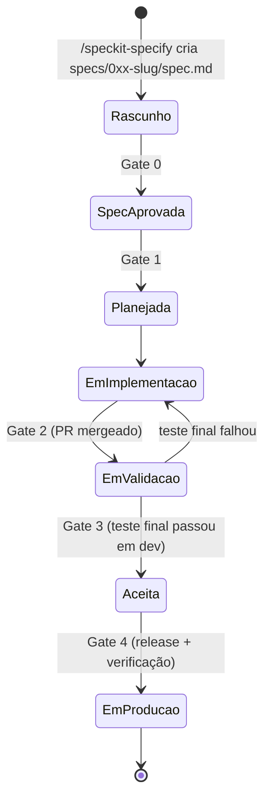

# 08 — Processo de desenvolvimento por feature

> Inspirado em *spec-driven development*: a Constituição define as regras do jogo, a spec define **o quê**,
> o plano define **como**, e o teste final de aceitação define **como saberemos que deu certo** — escrito
> **antes** de implementar.

## 1. Ciclo de vida de uma feature

O campo **Status** no topo de cada spec reflete este estado.

## 2. Etapas e gates

### Etapa 1 — Especificação (o quê e por quê)
Preencher a **Parte A** (seções 1–6) de `specs/0xx-slug/spec.md` (`/speckit-specify`, template em
[`.specify/templates/overrides/spec-template.md`](../../.specify/templates/overrides/spec-template.md)):
- **Contexto e problema**, **objetivo** e **fora de escopo**.
- **Requisitos funcionais** `Fxx-RF-nn` — comportamento observável pelo usuário, cada um testável.
- **Requisitos técnicos / não funcionais** `Fxx-RT-nn` — desempenho, segurança, observabilidade, compatibilidade.
- **Teste final de aceitação** em Gherkin, com cada cenário referenciando os RFs que cobre.

**Gate 0 — Spec aprovada** (dono do produto + dev):
- [ ] Todo RF é verificável e aparece em pelo menos um cenário de aceitação.
- [ ] Fora de escopo explícito.
- [ ] Seção "Conformidade com a Constituição" preenchida, sem violações não justificadas.
- [ ] Dependências identificadas e já entregues (ou planejadas antes).

### Etapa 2 — Plano técnico (como)
Preencher `plan.md` (seções 7 e 9, `/speckit-plan`) e `tasks.md` (seção 8, `/speckit-tasks`):
- **Desenho**: componentes afetados, contratos de API (rotas, esquemas, eventos), modelo de dados,
  mudanças de infraestrutura, flags.
- **Decisões**: se alguma for estrutural, criar ADR.
- **Tarefas**: lista ordenada, cada uma ≤ 1 dia, com o teste que a acompanha.
- **Plano de testes**: o que é coberto em unit/integração/contrato/E2E/evals.

**Gate 1 — Plano aprovado**:
- [ ] Contrato da API definido antes do código (permite front e back em paralelo).
- [ ] Riscos e plano de rollback descritos.
- [ ] Estimativa cabe na fase do roadmap; senão, a feature é dividida.

### Etapa 3 — Implementação
- Branch `feat/Fxx-slug`, PRs pequenos (≤ 400 linhas alteradas, idealmente).
- TDD onde fizer sentido: começar pelos testes de domínio e pelo teste final (que fica vermelho até o fim).
- O template de PR (`.github/pull_request_template.md`) exige: feature/RFs atendidos, checklist da Constituição,
  evidências de teste.

**Gate 2 — Merge**:
- [ ] CI verde (lint, tipos, testes, cobertura, contrato, segurança, evals se aplicável).
- [ ] Review aprovado.
- [ ] Spec atualizada se o escopo mudou.

### Etapa 4 — Validação (teste final de aceitação)
- O pipeline implanta em **dev** e roda os cenários de aceitação automatizados da feature (Playwright ou
  testes de integração contra a API em dev).
- Para itens não automatizáveis (ex.: aparência, texto do agente), um roteiro manual curto na própria spec.
- Resultado registrado na seção **11. Evidências** da spec: link da execução do CI, screenshots/vídeo do Playwright,
  data e versão.

**Gate 3 — Aceite**:
- [ ] Todos os cenários de aceitação passaram em dev.
- [ ] Matriz de rastreabilidade RF → teste completa (nenhum RF sem teste).
- [ ] Dono do produto aceitou.

### Etapa 5 — Produção
**Gate 4 — Verificação pós-deploy** (até 24 h após o release):
- [ ] Canário cumpriu SLOs.
- [ ] Indicador observável da feature (Artigo IX) está sendo reportado.
- [ ] Smoke de produção (subconjunto do teste final, com conta de teste) passou.

## 3. Definition of Ready (DoR) e Definition of Done (DoD)

| DoR — pode começar a implementar | DoD — feature concluída |
|---|---|
| Gate 0 e Gate 1 aprovados | Gates 2, 3 e 4 aprovados |
| Contrato de API publicado (OpenAPI parcial) | Teste final automatizado no pipeline de `master` |
| Dados de teste/sandbox disponíveis | Documentação de usuário atualizada (página "Sobre"/ajuda) |
| Dependências entregues | Runbook/alertas atualizados se houver nova operação |
| | Status da spec = `Em produção` |

## 4. Rastreabilidade

Cada spec termina com uma matriz:

| Requisito | Teste(s) | Tipo | Status |
|---|---|---|---|
| F05-RF-01 | `AT-F05-01` / `backend/tests/integration/test_chat_stream.py::test_stream_tokens` | aceitação / integração | ✅ |

Convenções:
- Cenários de aceitação: `AT-Fxx-nn`.
- Nos testes, marcar com o ID: `@pytest.mark.req("F05-RF-01")` (pytest) e `test("AT-F05-01 ...")` (Playwright).
- Um script do CI (`scripts/trace_requirements.py`) lê as specs e os testes e **falha se algum RF não tiver teste**.

## 5. Papéis

| Papel | Responsabilidade |
|---|---|
| Dono do produto (PO) | Aprova Gate 0 e Gate 3; prioriza o roadmap |
| Dev(s) | Escreve spec técnica e plano, implementa, aprova Gate 1/2 em par |
| Revisor | Revisa PR contra Constituição e spec (pode ser o próprio dev + Claude Code em `/code-review`) |

## 6. Cadência

- **Semanal:** revisão do roadmap (30 min) — status das specs, riscos, próxima feature a entrar em Gate 0.
- **Por fase:** demo do marco (M0–M3) e retrospectiva curta; ajustes na Constituição só via emenda.

## 7. Usando assistentes de IA no processo

- Claude Code pode gerar o rascunho da spec a partir de uma conversa, o plano a partir da spec e os testes a
  partir dos cenários Gherkin — mas os **gates continuam humanos**.
- Prompt sugerido: *"Leia `.specify/memory/constitution.md` e `specs/005-agente-chat-api/spec.md`. Gere o plano técnico
  (Parte B, seções 7–9) respeitando a Constituição e a arquitetura em `03-arquitetura.md`."*
