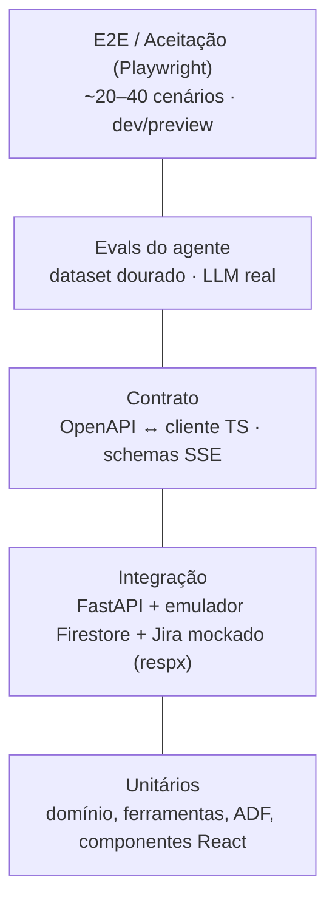

# 09 — Estratégia de testes

## 1. Pirâmide



| Camada | Ferramentas | Onde roda | Bloqueia merge? |
|---|---|---|---|
| Unitários back | pytest, freezegun | CI (todo PR) | Sim |
| Unitários front | Vitest, Testing Library, MSW | CI (todo PR) | Sim |
| Integração back | pytest + Firebase Emulator Suite + respx (Jira) + LLM fake | CI (todo PR) | Sim |
| Autorização | pytest: matriz rota × (sem token, token de outro usuário, token válido) | CI (todo PR) | Sim |
| Contrato | `openapi-typescript` gera cliente; `git diff --exit-code`; schemas dos eventos SSE validados | CI (todo PR) | Sim |
| Evals rápidas | 10–15 casos com LLM real, quando `backend/app/agent/**` muda | CI (PR) | Sim, se regressão > limite |
| E2E smoke | Playwright no preview do PR | CI (PR com label `preview`) | Sim |
| E2E completo / aceitação | Playwright em dev, Jira sandbox, usuário de teste | Pós-merge | Bloqueia promoção a prd |
| Evals completas | 60+ casos, LLM real | Diário + antes de release | Bloqueia release se regressão |
| Acessibilidade | axe-core dentro dos testes Playwright | Junto do E2E | Sim (violações sérias/críticas) |
| Carga | k6 / Locust no `/messages` com LLM fake | Antes do GA (F11) e sob demanda | — |
| Segurança | gitleaks, pip-audit, npm audit, trivy (imagem), ZAP baseline (pré-GA) | CI | Sim (alto/crítico) |

## 2. Como testar o agente sem depender do LLM

- **Unitários de ferramentas:** chamam a função de domínio com um `JiraClient` falso; não envolvem LLM.
- **Integração do grafo:** `GenericFakeChatModel` / modelo *scripted* que devolve tool calls pré-definidas
  (ex.: "chame `propor_criacao_issue` com X") — testa orquestração, persistência, eventos SSE e ações propostas
  de forma determinística.
- **Evals (LLM real):** verificam comportamento — escolha correta de ferramenta, formato BDD, pedir projeto
  quando não informado, nunca executar escrita sem proposta. Métricas determinísticas (regex/estrutura) +
  LLM-como-juiz com rubrica para qualidade textual.

## 3. Dados e ambientes de teste

| Recurso | Local/CI | dev |
|---|---|---|
| Firestore | Emulador (limpo a cada teste) | Banco dev; usuários de teste com prefixo `e2e-` limpos diariamente |
| Auth | Emulador | Usuário de teste dedicado (credenciais no GitHub Environment `dev`) |
| Jira | respx com fixtures gravadas da API v3 | Site Jira sandbox (ex.: `functional-agent-sandbox.atlassian.net`), projeto `E2E` |
| LLM | Fake/scripted | Modelo real com cota baixa |

## 4. Metas de qualidade

- Cobertura de linhas: back ≥ 80%, front ≥ 70% (código novo, medido no PR).
- Tempo do CI de PR ≤ 10 min.
- Flaky tests: quarentena proibida; teste instável é corrigido em até 2 dias ou o PR que o tocou é revertido.

## 5. Teste final de aceitação — como é escrito

Cada spec traz cenários Gherkin. Exemplo (F06):

```gherkin
Funcionalidade: Confirmação humana antes de escrever no Jira

  Cenário: AT-F06-01 Criar story somente após confirmação   # cobre F06-RF-01, F06-RF-02, F06-RF-04
    Dado que estou autenticado e com uma conexão Jira válida para o projeto "E2E"
    Quando peço ao agente "crie uma story de login com e-mail no projeto E2E"
    Então vejo um cartão "Criar Story em E2E" com título e descrição renderizados
    E nenhum issue novo existe no projeto "E2E"
    Quando clico em "Confirmar"
    Então vejo a mensagem "E2E-<n> criado" com link para o Jira
    E o issue "E2E-<n>" existe no Jira com a descrição exibida no cartão
```

Os cenários são implementados em `frontend/e2e/Fxx-*.spec.ts` (Playwright) ou
`backend/tests/acceptance/test_fxx_*.py` (API), sempre com o ID no nome do teste.
