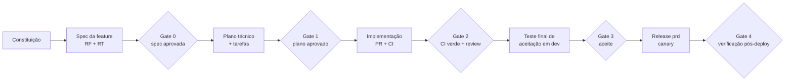

# Plano de Modernização — Agente Funcional

> **Status:** Proposta v1.0 · **Data:** 2026-11-13 · **Branch:** `claude/practical-cannon-iswdyv`
> **Escopo:** migrar o app Streamlit atual para **frontend React próprio** + **backend Python (FastAPI)**,
> hospedados em **Firebase Hosting** + **Google Cloud Run**, com **Firestore** como armazenamento por usuário.

---

## 1. Resumo executivo

O Agente Funcional hoje é um app Streamlit monolítico (~700 linhas) que mistura interface, agente de IA
(LangChain) e integração com o Jira no mesmo processo. Ele funciona como protótipo, mas **não está pronto
para múltiplos usuários**: o histórico do chat é compartilhado entre todas as sessões, credenciais do Jira
vivem em memória sem proteção, nada é persistido, não há testes, CI nem infraestrutura como código
(detalhes em [01 — Diagnóstico](01-diagnostico.md)).

A proposta é reconstruir o produto em uma arquitetura serverless na GCP:

| Camada | Hoje | Alvo |
|---|---|---|
| Interface | Streamlit (Python) | **React + TypeScript + Vite**, servido pelo **Firebase Hosting** |
| API / Agente | Dentro do Streamlit | **FastAPI (Python 3.12)** em **Cloud Run**, agente com **LangGraph** |
| Identidade | Nenhuma | **Firebase Authentication** (Google + e-mail/senha) |
| Dados do usuário | `st.session_state` (perdido no refresh) | **Firestore** (conversas, mensagens, issues, conexões Jira) |
| Segredos | `.env` / campo de texto | **Secret Manager** (chaves do app) + **Cloud KMS** (tokens Jira por usuário) |
| Entrega | Manual (`make run`) | **GitHub Actions** + **Terraform** + Workload Identity Federation |

**Firestore é necessário?** Sim. Assim que existirem usuários autenticados, o app precisa guardar por
usuário: conexões com o Jira, histórico de conversas, issues exportados e ações pendentes de confirmação.
Firestore é a escolha recomendada (serverless, escala a zero, nível gratuito, integração nativa com Firebase
Auth, modelo de documentos que encaixa em chat). A justificativa e as alternativas estão em
[ADR-001](adr/ADR-001-firestore.md).

**Estimativa:** MVP em produção em **~11 semanas** com 1 dev full-stack (ou ~7 semanas com 2 devs, front e
back em paralelo). Ver [Roadmap](../../specs/ROADMAP.md).

---

## 2. Como ler este plano

| # | Documento | Pergunta que responde |
|---|---|---|
| 01 | [Diagnóstico do estado atual](01-diagnostico.md) | O que existe hoje e o que precisa mudar? |
| 02 | [Constituição do projeto](02-constituicao.md) | Quais princípios são inegociáveis em toda feature? |
| 03 | [Arquitetura alvo](03-arquitetura.md) | Como o sistema fica desenhado (diagramas, dados, fluxos)? |
| 04 | [Stack tecnológica](04-stack.md) | Que tecnologias e versões, e por quê? |
| 05 | [Infraestrutura](05-infraestrutura.md) | Que recursos GCP/Firebase, IAM, ambientes e custos? |
| 06 | [CI/CD e deploy](06-cicd-deploy.md) | Como o código vai do PR até produção, e como volta (rollback)? |
| 07 | [Roadmap e índice de features](../../specs/ROADMAP.md) | Em que ordem, em quais fases, com quais marcos? |
| 08 | [Processo de desenvolvimento](08-processo-de-desenvolvimento.md) | Como cada feature é especificada, planejada, implementada e **validada**? |
| 09 | [Estratégia de testes](09-estrategia-de-testes.md) | Que testes existem em cada camada e o que bloqueia um merge? |
| — | [ADRs](adr/) | Decisões arquiteturais registradas, com alternativas descartadas |
| — | [Features](../../specs/) | Uma pasta por feature (`spec.md`, `plan.md`, `tasks.md`): requisitos, plano, teste final |

### Fluxo de trabalho resumido

---

## 3. Índice de features

> Status, dependências e estimativas atualizados ficam em [`specs/ROADMAP.md`](../../specs/ROADMAP.md).

| ID | Feature | Fase | Spec |
|---|---|---|---|
| F01 | Monorepo, tooling e CI base | 0 — Fundação | [F01](../../specs/001-monorepo-e-ci/spec.md) |
| F02 | Infraestrutura base GCP/Firebase (Terraform) | 0 — Fundação | [F02](../../specs/002-infraestrutura-base/spec.md) |
| F03 | Autenticação e conta do usuário | 1 — Núcleo | [F03](../../specs/003-autenticacao/spec.md) |
| F04 | Conexão Jira por usuário | 1 — Núcleo | [F04](../../specs/004-conexao-jira/spec.md) |
| F05 | API de chat com agente (LangGraph + streaming) | 1 — Núcleo | [F05](../../specs/005-agente-chat-api/spec.md) |
| F06 | Confirmação humana antes de escrever no Jira | 1 — Núcleo | [F06](../../specs/006-confirmacao-humana/spec.md) |
| F07 | Conversas persistentes | 2 — Produto | [F07](../../specs/007-conversas-persistentes/spec.md) |
| F08 | Interface de chat em React | 2 — Produto | [F08](../../specs/008-interface-chat/spec.md) |
| F09 | Projetos Jira | 2 — Produto | [F09](../../specs/009-projetos-jira/spec.md) |
| F10 | Histórico de issues criados | 2 — Produto | [F10](../../specs/010-historico-issues/spec.md) |
| F11 | Observabilidade, limites de uso e proteção | 3 — Produção | [F11](../../specs/011-observabilidade-e-limites/spec.md) |
| F12 | Go-live e desativação do Streamlit | 3 — Produção | [F12](../../specs/012-go-live/spec.md) |
| F13 | Login Atlassian via OAuth 2.0 (3LO) | 4 — Evolução | [F13](../../specs/013-oauth-atlassian/spec.md) |
| F14 | Editor de artefatos antes da exportação | 4 — Evolução | [F14](../../specs/014-editor-artefatos/spec.md) |
| F15 | Suíte contínua de avaliação do agente (evals) | 4 — Evolução | [F15](../../specs/015-evals-agente/spec.md) |

---

## 4. Decisões que precisam do dono do produto

Estas escolhas têm um padrão recomendado no plano, mas mudam escopo ou custo — confirme antes do Gate 0 da F02:

1. **Domínio próprio** (ex.: `app.seudominio.com` e `api.seudominio.com`)? Recomendado; sem domínio o app usa
   `*.web.app` e a URL `*.run.app` do Cloud Run.
2. **Região**: recomendado `southamerica-east1` (São Paulo) para Cloud Run, Firestore e KMS.
3. **Provedor de LLM**: o plano mantém OpenAI (já usado), atrás de uma interface que permite trocar de
   provedor por configuração.
4. **Ambiente de staging**: o plano prevê `dev` + `prd`; `stg` é opcional (custo baixo, mais segurança no release).
5. **Instância mínima em produção** (`min-instances=1`): elimina cold start ao custo de alguns dólares/mês.
