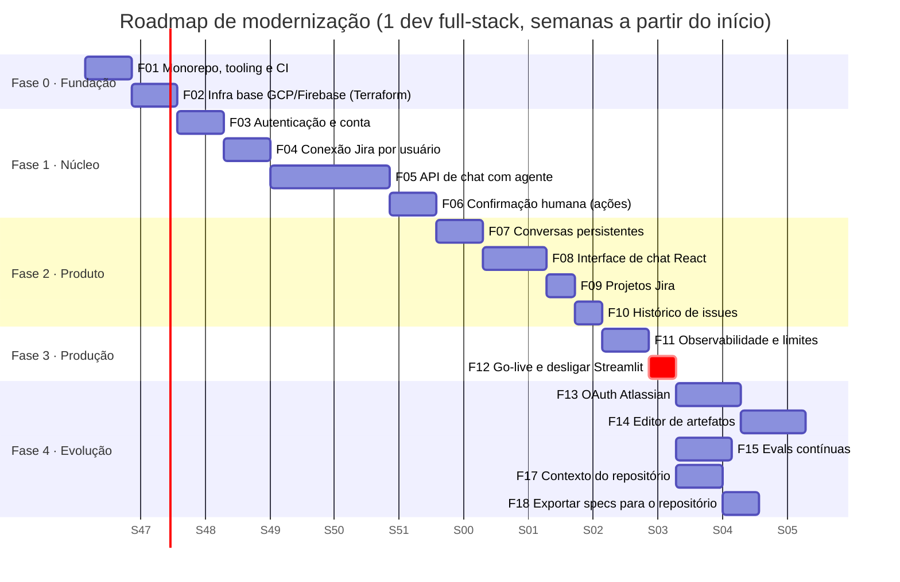
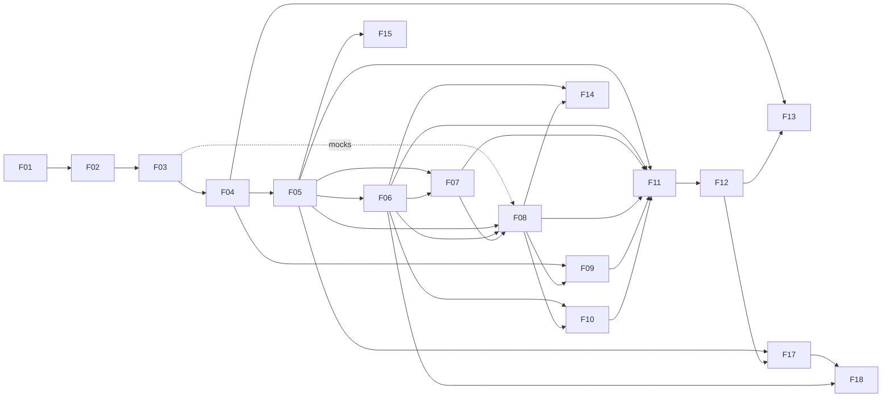

# Roadmap e índice de features

> Fonte de verdade das features do Agente Funcional. Cada feature vive em `specs/0xx-slug/`
> (`spec.md` = Gate 0 e validação, `plan.md` = Gate 1, `tasks.md` = tarefas), no formato do Spec Kit.
> O ID `Fxx` corresponde ao número da pasta (`F05` → `specs/005-…`). Regras: [Constituição](../.specify/memory/constitution.md)
> · processo: [08 — Processo de desenvolvimento](../docs/modernizacao/08-processo-de-desenvolvimento.md)
> · contexto técnico: [plano de modernização](../docs/modernizacao/README.md).

## 0. Índice de features

| ID | Feature | Fase | Status | Depende de | Est. | RF / RT | Artefatos |
|---|---|---|---|---|---|---|---|
| F01 | Monorepo, tooling e CI base | 0 | Em implementação | — | 5 d | 5 / 7 | [spec](001-monorepo-e-ci/spec.md) · [plano](001-monorepo-e-ci/plan.md) · [tarefas](001-monorepo-e-ci/tasks.md) |
| F02 | Infraestrutura base GCP/Firebase (Terraform) e deploy por `make deploy` | 0 | Em implementação | F01 | 5 d | 4 / 8 | [spec](002-infraestrutura-base/spec.md) · [plano](002-infraestrutura-base/plan.md) · [tarefas](002-infraestrutura-base/tasks.md) |
| F03 | Autenticação e conta do usuário | 1 | Em produção | F02 | 6,5 d | 8 / 6 | [spec](003-autenticacao/spec.md) · [plano](003-autenticacao/plan.md) · [tarefas](003-autenticacao/tasks.md) |
| F04 | Conexão Jira por usuário | 1 | Em produção | F03 | 5 d | 7 / 6 | [spec](004-conexao-jira/spec.md) · [plano](004-conexao-jira/plan.md) · [tarefas](004-conexao-jira/tasks.md) |
| F05 | API de chat com agente (LangGraph + Gemini no Vertex AI + streaming), escrevendo specs prontas para agentes de código | 1 | Em produção | F04 | 12,5 d | 12 / 15 | [spec](005-agente-chat-api/spec.md) · [plano](005-agente-chat-api/plan.md) · [tarefas](005-agente-chat-api/tasks.md) |
| F06 | Confirmação humana antes de escrever no Jira (com prontidão para agente) | 1 | Em produção | F05 | 5,5 d | 9 / 7 | [spec](006-confirmacao-humana/spec.md) · [plano](006-confirmacao-humana/plan.md) · [tarefas](006-confirmacao-humana/tasks.md) |
| F07 | Conversas persistentes | 2 | Em produção | F05, F06 | 5 d | 6 / 5 | [spec](007-conversas-persistentes/spec.md) · [plano](007-conversas-persistentes/plan.md) · [tarefas](007-conversas-persistentes/tasks.md) |
| F08 | Interface de chat em React | 2 | Em produção | F03 (mocks), F05, F06, F07 | 9.5 d | 11 / 8 | [spec](008-interface-chat/spec.md) · [plano](008-interface-chat/plan.md) · [tarefas](008-interface-chat/tasks.md) |
| F09 | Projetos Jira | 2 | Em validação | F04, F08 | 3 d | 7 / 6 | [spec](009-projetos-jira/spec.md) · [plano](009-projetos-jira/plan.md) · [tarefas](009-projetos-jira/tasks.md) |
| F10 | Histórico de issues criados (com "Copiar para agente de código") | 2 | Rascunho (revisado em 2026-11-16) | F06, F08 | 3,5 d | 7 / 4 | [spec](010-historico-issues/spec.md) · [plano](010-historico-issues/plan.md) · [tarefas](010-historico-issues/tasks.md) |
| F11 | Observabilidade, limites de uso e proteção | 3 | Rascunho | F05–F10 | 5 d | 4 / 10 | [spec](011-observabilidade-e-limites/spec.md) · [plano](011-observabilidade-e-limites/plan.md) · [tarefas](011-observabilidade-e-limites/tasks.md) |
| F12 | Go-live e desativação do Streamlit | 3 | Rascunho | F01–F11 | 3 d | 3 / 3 | [spec](012-go-live/spec.md) · [plano](012-go-live/plan.md) · [tarefas](012-go-live/tasks.md) |
| F13 | Login Atlassian via OAuth 2.0 (3LO) | 4 | Rascunho · plano após GA | F04, F12 | 7 d | 4 / 4 | [spec](013-oauth-atlassian/spec.md) · [plano](013-oauth-atlassian/plan.md) |
| F14 | Editor de artefatos antes da exportação (por seção do contrato) | 4 | Rascunho · plano após GA | F06, F08 | 7 d | 6 / 4 | [spec](014-editor-artefatos/spec.md) · [plano](014-editor-artefatos/plan.md) |
| F15 | Suíte contínua de avaliação do agente (evals, incluindo prontidão e implementabilidade) | 4 (baseline na 1) | Rascunho · plano após GA | F05 | 6 d | 4 / — | [spec](015-evals-agente/spec.md) · [plano](015-evals-agente/plan.md) |
| F16 | Google Analytics (consentimento LGPD, CSP, eventos) | 4 | A especificar (aprovado pelo PO em 2026-11-14) | F02, F08 | — | — | — |
| F17 | Contexto do repositório (GitHub, só leitura) para "Onde mexer" | 4 | Rascunho · plano após GA | F05, F12 | 5 d | 4 / 3 | [spec](017-contexto-repositorio/spec.md) |
| F18 | Exportar specs para o repositório (formato Spec Kit, por PR) | 4 | Rascunho · plano após GA | F06, F17 | 4 d | 4 / 2 | [spec](018-exportar-specs-repositorio/spec.md) |

**Totais:** 17 features especificadas (F16 a especificar) · 103 requisitos funcionais · 99 técnicos · ~97,5 dias de estimativa
(contados nas specs em 2026-11-16).
Status, dependências e estimativas vêm do cabeçalho de cada `spec.md` — atualize lá e reflita aqui.

> **Revisão de 2026-11-16 — specs para agentes de código.** O leitor principal das issues que o SpecFlow cria passa a
> ser um agente de IA de código. Requisitos em [doc 10](../docs/modernizacao/10-specs-para-agentes.md), decisão em
> [ADR-007](../docs/modernizacao/adr/ADR-007-spec-pronta-para-agente.md), Artigo XII da Constituição (v2.1.0).
> Mudaram F05 (+2 d), F06 (+0,5 d), F10 (+0,5 d), F14 e F15 (+1 d); entraram F17 e F18 na Fase 4.
>
> **Revisão de 2026-11-16 — LLM do agente.** Gemini no Vertex AI (modelo padrão `gemini-3.5-flash-lite`) no lugar
> de OpenAI, mantendo LangGraph; limite da imagem do backend sobe para 400 MiB
> ([ADR-008](../docs/modernizacao/adr/ADR-008-llm-gemini-vertex.md), Constituição v2.2.0). F05 ganha a T010 (+0,5 d).

Nova feature: `/speckit-specify <descrição>` cria `specs/019-…/spec.md` a partir do template do
projeto (`.specify/templates/overrides/spec-template.md`); depois `/speckit-plan` e `/speckit-tasks`.

## 1. Visão das fases

> Com **2 devs** (front e back), F08 começa logo após F03 usando mocks (MSW) gerados do contrato OpenAPI,
> e o MVP cai de ~11 para ~7 semanas.

## 2. Fases, objetivos e marcos

### Fase 0 — Fundação (semanas 1–2)
**Objetivo:** esqueleto que vai do commit à URL pública em dev, com qualidade automatizada.
- F01 Monorepo, tooling e CI · F02 Infra base.
- **Marco M0:** "hello world" do React no Hosting chamando `/healthz` do Cloud Run em dev, publicado só pelo pipeline.

### Fase 1 — Núcleo (semanas 3–7)
**Objetivo:** paridade de capacidade do agente com o app atual, de forma segura e multiusuário, já escrevendo
issues no formato "spec pronta para agente de código" (ADR-007).
- F03 Autenticação · F04 Conexão Jira · F05 Agente + streaming · F06 Confirmação humana.
- **Marco M1:** via API, um usuário autenticado conversa com o agente, consulta o Jira e cria, após confirmar, uma
  issue `agent-ready` que um agente de código consegue implementar.

### Fase 2 — Produto (semanas 7–10)
**Objetivo:** experiência completa no React, superior à do Streamlit.
- F07 Conversas persistentes · F08 Interface de chat · F09 Projetos · F10 Histórico de issues.
- **Marco M2:** paridade funcional com o Streamlit + histórico persistente; beta fechado com 3–5 POs.

### Fase 3 — Produção (semanas 10–11)
**Objetivo:** operar com segurança e custo previsível.
- F11 Observabilidade e limites · F12 Go-live.
- **Marco M3 (GA):** app em produção, Streamlit desligado, SLOs medidos.

### Fase 4 — Evolução (após GA, priorizar por feedback)
- F13 OAuth Atlassian (elimina API token manual) · F14 Editor de artefatos · F15 Evals contínuas (com eval de
  implementabilidade) · F17 Contexto do repositório · F18 Exportar specs para o repositório.
- Ideias de backlog (sem spec ainda): templates de documentação por empresa, exportar para Confluence, títulos de seção em inglês,
  atribuir a issue direto a um agente de código (Rovo Dev, Copilot para Jira), ler o resultado do PR de volta,
  análise de lacunas do backlog (épicos sem critério de aceite), priorização impacto × esforço,
  workspaces compartilhados entre membros do time, suporte a múltiplos provedores de LLM na UI.

## 3. Dependências entre features

Derivado do campo **Dependências** de cada spec (setas tracejadas = dependência fraca).

> Ordem de execução (Fase 4): F13, F14 e F15 ficam **após o GA** (F12) por decisão de roadmap,
> mesmo quando a spec não depende tecnicamente de F12.

## 4. Critérios de sucesso do programa

| Métrica | Hoje | Meta no GA |
|---|---|---|
| Vazamento de dados entre usuários | Possível (D01) | 0 — coberto por testes de autorização |
| Escritas no Jira sem confirmação | Possível | 0 — garantido em código |
| Tempo até o primeiro token | Resposta inteira + animação falsa | p75 ≤ 3 s |
| Histórico após refresh | Perdido | 100% persistido |
| Cobertura de testes | 0% | back ≥ 80%, front ≥ 70% |
| Tempo de deploy (merge → prd) | Manual | ≤ 30 min, com rollback ≤ 5 min |
| Disponibilidade | — | 99,5% mensal |
| Stories geradas no formato BDD válido | Não medido | ≥ 95% nas evals |

## 5. Riscos

| Risco | Prob. | Impacto | Mitigação |
|---|---|---|---|
| Comportamento do agente muda ao migrar para LangGraph e Gemini (ADR-008) | Média | Alto | Evals de baseline gravadas **antes** da migração (F05) com o prompt atual |
| Conversão Markdown → ADF incompleta | Média | Médio | Suportar subconjunto (títulos, listas, negrito, código, tabelas); fallback para parágrafo; testes com fixtures |
| Rate limit/timeout do Jira | Média | Médio | Retries com backoff, limites nas ferramentas, cache curto de projetos |
| Custo de LLM acima do esperado | Média | Médio | Cotas por usuário, sumarização do histórico, alerta de orçamento |
| Limite de 60 s se alguém usar rewrite do Hosting para o chat | Baixa | Alto | ADR-002: chat sempre direto no Cloud Run; teste E2E com turno longo |
| Escopo cresce durante a migração | Alta | Médio | Paridade primeiro; novidades só na Fase 4; Gate 0 rejeita escopo extra |
| Dev único (fator ônibus) | Alta | Médio | Constituição, ADRs, specs e runbooks versionados |
